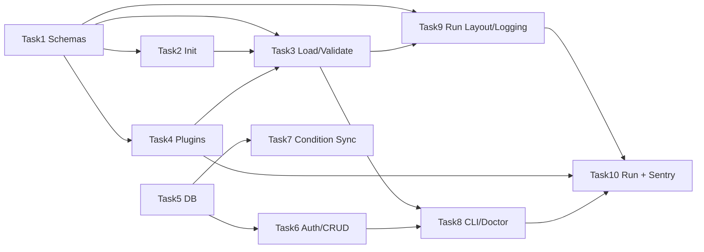

# Stage 1 — Implementation plan (one PR per task)

Stage 1 establishes the core contract: **schemas**, **study folder + init**, **config loading/validation**, **plugin registry**, **Supabase backend** (Postgres + Auth), **CLI** (init, validate, run, doctor, db, auth, participants, sessions, condition sync), **run layout/logging**, and **minimal run + Sentry**. Each task below is scoped to **one meaningful PR** with tests and documentation. Implementation refactors and generalizes behavior from the **legacy repo** at `/Users/alisaberi/Desktop/Projects/slumber`.

---

## Legacy reference (what we port/generalize)

| Area                    | Legacy location                                                                                                                                                                                                                                                                                                   | New approach                                                                                                    |
| ----------------------- | ----------------------------------------------------------------------------------------------------------------------------------------------------------------------------------------------------------------------------------------------------------------------------------------------------------------- | --------------------------------------------------------------------------------------------------------------- |
| **DAG**                 | `[slumber/models/dag.py](/Users/alisaberi/Desktop/Projects/slumber/slumber/models/dag.py)`: `ComponentConfig(name, unit, settings)`, `DAG(components, connections, process_components)`, connection/process validation                                                                                            | Plugin-keyed `unit_type` (string); no direct `slumber.dag.units` import; same validation semantics              |
| **Procedure/Task**      | `[slumber/models/gui.py](/Users/alisaberi/Desktop/Projects/slumber/slumber/models/gui.py)`: `Task(title, widget, kwargs)`, `Procedure(tasks, …)`, `GUI(pre_sleep, awakening, post_sleep, wbtb)`                                                                                                                   | UI-agnostic `TaskSpec(type, title, kwargs)`; procedures stay per-condition; rename `gui` → `procedures` in YAML |
| **Condition load/sync** | `[slumber/models/condition.py](/Users/alisaberi/Desktop/Projects/slumber/slumber/models/condition.py)`: `load_condition_file`, `update_condition_from_config`; `[slumber/scripts/update_conditions.py](/Users/alisaberi/Desktop/Projects/slumber/slumber/scripts/update_conditions.py)`: `--conditions` / `--all` | Load from `conditions/`; sync CLI pushes condition configs from study folder into Supabase (condition sync)     |
| **Condition YAML**      | `[configs/conditions/condition_1.yaml](/Users/alisaberi/Desktop/Projects/slumber/configs/conditions/condition_1.yaml)`: `name`, `gui` (procedures + tasks with `widget`), `dag`                                                                                                                                   | Same shape with `procedures` and task `type`; study-scoped paths                                                |

---

## Task 1 — Core schemas (Study, Condition, Procedure/Task, DAG)

**Goal:** Pydantic schemas for Study manifest, Condition (multi-procedure + DAG), UI-agnostic Procedure/Task, and DAG (plugin-keyed components/connections). Replaces legacy `dag.py` / `gui.py` usage with framework schemas.

**Refactor from legacy:**

- **DAG**: Port structure and validation from `[slumber/models/dag.py](src/slumber/schemas/)` — `components` (name, **unit_type** string, settings), `connections` as list of (output_stream, input_stream), `process_components`; keep connection and process_components validation logic but **do not** resolve `unit` to a class here (plugin resolution in a later layer).
- **Procedure/Task**: Port from `[slumber/models/gui.py](/Users/alisaberi/Desktop/Projects/slumber/slumber/models/gui.py)` — `Task(type, title, kwargs)` (replacing `widget` with `type`), `Procedure(tasks, show_item_list?, allow_skip_tasks?)`; condition-level structure with named procedures: `pre_sleep`, `awakening`, `post_sleep`, `wbtb` (optional).
- **Study**: New manifest schema per [PLAN.md](PLAN.md): `study_id`, `name`, `conditions_dir`, `runs` (base_directory, layout with placeholders), `logging` (level, handlers with loguru `add()` kwargs), `ui` (backend, config).
- **Condition**: One condition = named procedures (same keys as legacy) + `dag`; condition identity by filename or explicit `name`.

**Deliverables:**

- `src/slumber/schemas/` (e.g. `study.py`, `condition.py`, `procedure.py`, `dag.py`); re-export from `schemas/__init__.py`.
- Tests: validation (valid/invalid) for Study, Condition, Procedure, Task, DAG (including connection and process_components checks).
- Docs: Schema reference (study manifest, condition file, procedure/task, DAG) in `docs/` or inline.

**PR:** One commit adding schemas, tests, and schema docs.

---

## Task 2 — Study folder structure and `slumber study init`

**Goal:** Define standard study layout and implement init wizard so researchers get a study folder with manifest, conditions dir, and assets.

**Refactor from legacy:** Legacy has a single `CONDITIONS_DIR` and condition files; no study manifest. New: one study = one folder with `study.yaml` and `conditions/` (and optional `assets/`), per [PLAN.md](PLAN.md).

**Deliverables:**

- Study layout: `<study_id>/study.yaml`, `<study_id>/conditions/`, `<study_id>/assets/`.
- CLI: `slumber study init` — prompt for base dir (default `.`) and study_id (or `--base-dir`, `--study-id`); create `<base_dir>/<study_id>/` with template `study.yaml`, empty `conditions/` and `assets/`.
- Optionally create `.env.example` and first env file at **project root** (base_dir) if missing; add `.env` and `.env.`* to project root `.gitignore` (document in user guide).
- Tests: init creates correct layout; non-interactive with args.
- Docs: Study folder structure; init command and options; .gitignore and .env.example.

**PR:** One commit for init command, layout, .gitignore, tests, and docs.

---

## Task 3 — Config loading and validation (study discovery, validate)

**Goal:** Load study from current directory or `--study-dir`; load conditions from manifest’s `conditions_dir`; validate with Pydantic and emit clear, path-specific errors.

**Refactor from legacy:** Legacy loads a single condition file via `load_condition_file` and validates with `Condition.model_validate` / `DAG.model_validate` / `GUI.model_validate`. New: load full study (manifest + all condition files), normalize paths relative to study dir, validate and optionally resolve plugin keys (or defer resolution to run).

**Deliverables:**

- `src/slumber/config/` (e.g. `load.py`, `study_loader.py`, `errors.py`): load study dir → Study + list of Condition; pretty-print Pydantic errors (path, message).
- CLI: `slumber study validate` when run from study folder (discover `study.yaml` in cwd); optional `--study-dir <path>`.
- Tests: load valid/invalid study and condition files; validate command; error output shape.
- Docs: How study discovery works; validate command; error format.

**PR:** One commit for config loading, validate command, tests, and docs.

---

## Task 4 — Plugin registry (entry points)

**Goal:** Discover and resolve units, tasks, and UI backends via Python entry points; provide a single registry used by validate and run.

**Refactor from legacy:** Legacy resolves units via `create_class_by_name_resolver([units, ezutil], ez.Unit)` in `[slumber/models/dag.py](/Users/alisaberi/Desktop/Projects/slumber/slumber/models/dag.py)` and tasks via widget module scan in `[slumber/models/gui.py](/Users/alisaberi/Desktop/Projects/slumber/slumber/models/gui.py)`. New: no direct module scanning; resolution via entry-point groups `slumber.units`, `slumber.tasks`, `slumber.ui_backends`.

**Deliverables:**

- `src/slumber/plugins/registry.py`: `PluginRegistry` with `get_unit(type)`, `get_task(type)`, `get_ui_backend(key)`; load from entry points.
- `src/slumber/plugins/types.py`: Lightweight protocols/types for unit factory, task spec metadata, UI backend interface.
- Define entry-point group names in public API/docs.
- Ship **built-in** plugins: `slumber.ui_backends.headless`, one minimal task (e.g. `slumber.tasks.instruction` or `noop`) so validate/run can resolve without extensions.
- Tests: discovery and lookup (including missing plugin); built-in headless + task.
- Docs: Plugin contract; how to register units, tasks, UI backends.

**PR:** One commit for registry, types, built-in plugins, tests, and plugin docs.

---

## Task 5 — Supabase database schema and migrations

**Goal:** Postgres schema for Study, Condition, Participant, Session, Run; Participants linked to Supabase Auth (`auth.users`); migrations (Supabase migrations or Alembic to Postgres).

**Refactor from legacy:** Legacy uses SQLModel with SQLite and tables in `[slumber/models/condition.py](/Users/alisaberi/Desktop/Projects/slumber/slumber/models/condition.py)`, session, user, etc. New: Supabase (Postgres); same logical entities but Participant has `auth_user_id` (or equivalent) linking to `auth.users.id`.

**Deliverables:**

- DB models (e.g. `src/slumber/db/models.py` or Supabase SQL): Study, Condition (study_id, name, procedures JSON, dag JSON), Participant (study_id, participant_id, auth_user_id), Session, Run (with parent_run_id, status, run_directory, etc.).
- Migrations: Supabase migrations or Alembic; run via `slumber db migrate` or Supabase CLI.
- Env: `SUPABASE_URL`, `SUPABASE_ANON_KEY` (and optional service role for admin); document in backend docs.
- Tests: Migration up/down or integration against local Postgres/Supabase if feasible; otherwise unit tests for model/schema consistency.
- Docs: Backend setup (Supabase cloud/local); env vars; migration workflow.

**PR:** One commit for schema, migrations, env docs, and tests.

---

## Task 6 — Supabase Auth and participant/session CRUD

**Goal:** Use Supabase Auth for sign-up, sign-in, password change; Participant and Session CRUD via CLI/API; one user can link to many participants (one per study).

**Refactor from legacy:** Legacy has local User and session handling. New: Supabase Auth as source of identity; app tables link Participant to `auth.users`.

**Deliverables:**

- Auth: sign-up, sign-in, password change via Supabase client; document how researcher vs participant use it.
- CLI: `slumber auth login` (or rely on Supabase session); create participant linked to auth user (e.g. `slumber participant create --study-id …`); create/update/delete sessions (e.g. `slumber session create/list/…`).
- Tests: Auth flows and participant/session CRUD (mocked Supabase or integration).
- Docs: Auth; participant and session commands; linking user ↔ participant.

**PR:** One commit for auth integration, CLI commands, tests, and docs.

---

## Task 7 — Condition sync (push conditions to Supabase)

**Goal:** Sync condition configs from study folder `conditions/` into Supabase so the backend has current condition definitions.

**Refactor from legacy:** Direct port of behavior from `[slumber/scripts/update_conditions.py](/Users/alisaberi/Desktop/Projects/slumber/slumber/scripts/update_conditions.py)` and `[update_condition_from_config](/Users/alisaberi/Desktop/Projects/slumber/slumber/models/condition.py)` — iterate condition files, validate, then upsert into DB. New: run from study folder (or `--study-dir`); push to Supabase instead of local DB.

**Deliverables:**

- CLI: e.g. `slumber condition sync` (or `slumber study sync-conditions`) — load study, load all condition YAMLs from `conditions_dir`, validate, upsert Condition rows for that study in Supabase.
- Optional: `--conditions a b` to sync only listed condition IDs (mirror legacy `--conditions`).
- Tests: sync adds/updates conditions; invalid condition file fails with clear error.
- Docs: Condition sync command; when to run it.

**PR:** One commit for sync command, Supabase upsert, tests, and docs.

---

## Task 8 — CLI skeleton, doctor, and logging (loguru + verbose)

**Goal:** Typer-based CLI entry point; `slumber doctor`; loguru everywhere; verbose option on CLI.

**Deliverables:**

- `src/slumber/cli/main.py`: Typer app; wire existing commands (study init, study validate); add `slumber doctor` (environment, Supabase connectivity, optional deps).
- Update `pyproject.toml`: `slumber` script → `slumber.cli.main:app` (or equivalent Typer entry).
- Loguru: use loguru in new code; CLI `-v`/`--verbose` for increased verbosity.
- Tests: CLI invocation; doctor output when env present/missing.
- Docs: CLI reference (init, validate, doctor, verbose).

**PR:** One commit for CLI skeleton, doctor, loguru/verbose, tests, and CLI docs.

---

## Task 9 — Run directory layout and run logging from study settings

**Goal:** Run directory layout with placeholders (`participant_id`, `session_id`, `run_id`); configure loguru from study `runs.logging` (handlers passed to `logger.add()`; placeholders in sink paths).

**Refactor from legacy:** Legacy has run/output paths in settings; new: layout and logging come from study manifest per [PLAN.md](PLAN.md).

**Deliverables:**

- Run layout: resolve `runs.layout` with placeholders from run context; create run directory under `runs.base_directory`.
- Logging: from `study.runs.logging` (level + handlers); support placeholders in handler `sink` (e.g. `run_id`); apply when a run starts.
- Tests: layout resolution for sample placeholders; logging config application (no-op or single handler).
- Docs: Run directory layout; run logging (handlers, placeholders).

**PR:** One commit for run layout, run logging config, tests, and docs.

---

## Task 10 — `slumber study run` (minimal) and optional Sentry

**Goal:** End-to-end `slumber study run` from study folder: load study + condition, resolve plugins, create run directory, apply run logging, start minimal DAG + headless UI; optional Sentry init when `SENTRY_DSN` is set.

**Refactor from legacy:** Legacy runs DAG via `run_dag(dag)` and GUI separately; new: single run command that orchestrates config load, plugin resolution, run dir, DAG build from registry, and UI backend (headless) so “run” works without NiceGUI.

**Deliverables:**

- Orchestration: `src/slumber/runtime/` (or equivalent): create run dir, write metadata, build DAG from config + plugin registry, start headless UI with procedure from condition.
- CLI: `slumber study run` (from study dir or `--study-dir`); optionally `--session-id` / `--study-id` for DB-backed run in a later iteration if time.
- Sentry: if `SENTRY_DSN` set, init Sentry on run and set context (study_id, etc.); no-op when unset. Document in env/run docs.
- Tests: Integration test for run flow (minimal study + headless); Sentry no-op without DSN and context set with DSN (if testable without sending events).
- Docs: Run command; “first study” walkthrough (init → validate → run); optional Sentry for run monitoring.

**PR:** One commit for run orchestration, run command, Sentry, tests, and walkthrough docs.

---

## Dependency order (for implementation)

- **Task 1** is the base (schemas used everywhere).
- **Tasks 2, 4** depend only on Task 1; **Task 3** (load/validate) depends on 1, 2, 4.
- **Task 5** (DB) is independent of 2–4; **Task 6** (Auth/CRUD) and **Task 7** (condition sync) depend on 5.
- **Task 8** (CLI/doctor) uses 2, 3, 6.
- **Task 9** (run layout/logging) uses 1 and 3; **Task 10** (run + Sentry) uses 3, 4, 8, 9.

---

## Summary table

| Task | Focus                  | Legacy refactor                                    | PR content                                                   |
| ---- | ---------------------- | -------------------------------------------------- | ------------------------------------------------------------ |
| 1    | Core schemas           | DAG, Procedure/Task, Condition shape               | study/condition/procedure/dag schemas, tests, schema docs    |
| 2    | Study folder + init    | Study layout, no direct legacy equivalent          | init wizard, .gitignore/.env.example, tests, docs            |
| 3    | Config load + validate | load_condition_file, validate                      | load/validate, errors, tests, docs                           |
| 4    | Plugin registry        | Unit/task resolution from modules                  | entry points, registry, headless + minimal task, tests, docs |
| 5    | Supabase DB            | Condition/User/Session tables → Postgres           | schema, migrations, env, tests, docs                         |
| 6    | Auth + CRUD            | Local user → Supabase Auth + participants/sessions | auth, participant/session CLI, tests, docs                   |
| 7    | Condition sync         | update_conditions script                           | sync CLI, Supabase upsert, tests, docs                       |
| 8    | CLI + doctor           | N/A                                                | Typer app, doctor, loguru/verbose, tests, docs               |
| 9    | Run layout + logging   | Run paths and logging from study                   | layout, runs.logging, tests, docs                            |
| 10   | study run + Sentry     | run_dag + GUI launch                               | orchestrator, run command, Sentry, tests, walkthrough        |

Each task is intended to result in **one merge-ready PR** with implementation, tests, and documentation for that slice of Stage 1.