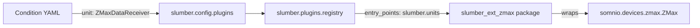

# ZMax extension migration plan

## Recommended choices

- **Dependency**: depend on your published `somnio` package (you selected this).
- **Scope (v1)**: ship **only a unit** (`ZMaxDataReceiver`) under `slumber.units`.
- **Unit key**: **change the name of unit to a more meaningful one**

## What exists today (why extension is the right fit)

- Condition DAGs reference units by a **string plugin key** (`Component.unit_type`) and validate/instantiate them via the plugin registry at runtime.
  - `Component.unit_type` is a string key resolved via `slumber.units` entry points: `/Users/alisaberi/Desktop/Projects/slumber-org/slumber/src/slumber/schemas/dag.py`.
  - Units are resolved via the registry and built from settings dicts: `/Users/alisaberi/Desktop/Projects/slumber-org/slumber/src/slumber/config/plugins.py`.
  - Plugin loading is via entry points in group `slumber.units`: `/Users/alisaberi/Desktop/Projects/slumber-org/slumber/src/slumber/plugins/registry.py`.
- This repo currently registers **no `slumber.units` entry points** in `pyproject.toml`, so ZMax belongs in an external plugin package.

## Target architecture

## Extension package layout (new repo)

- Create a new repo under the org, e.g. `slumber-zmax` (name flexible).
- Package name suggestion: `**slumber_zmax**` (importable module), distribution name `slumber-zmax`.
- Files (minimum):
  - `src/slumber_zmax/unit.py`
  - `src/slumber_zmax/__init__.py`
  - `pyproject.toml` with:
    - dependency on `slumber` and `somnio`
    - `[project.entry-points."slumber.units"]` mapping `zmax = "slumber_zmax.unit:ZMax"`

## Unit implementation approach (migration)

- Use the **legacy unit behavior** as the reference spec (`/Users/alisaberi/Desktop/Projects/slumber/slumber/dag/units/zmax.py`), but re-implement it against `somnio.devices.zmax.ZMax`.
- Define a settings model using Slumber’s unit settings helper (`/Users/alisaberi/Desktop/Projects/slumber-org/slumber/src/slumber/plugins/units/utils.py`):
  - `ip`, `port`, `socket_timeout`
  - `data_types` (strings or enum names mapped to Somnio’s `DataType`)
  - retry/backoff (`retry_attempts`, `retry_delay`)
  - optional `data_collection_enabled` gating (if you still want it; legacy had it)
  - timestamping strategy (see next bullet)
- Port the **timestamping** logic from legacy (synthetic monotonic clock + optional PLL + epoch anchor slewing). This matters for stable sample timing even with event-loop jitter.
- The unit emits whatever sample/message type Slumber expects downstream.
  - Decide whether to emit Somnio’s `Sample` directly or adapt into Slumber’s existing sample container type used elsewhere in the framework.

## Compatibility & documentation

- Add a short doc snippet in Slumber docs/README describing:
  - how to install: `pip install slumber-zmax` (or `uv add slumber-zmax`)
  - how to reference it in condition YAML: `unit: ZMaxDataReceiver` + example `settings`.
- Keep Slumber core unchanged except possibly adding docs links; plugin discovery already works.

## Verification

- In the extension repo:
  - unit tests that instantiate the unit via Slumber plugin registry and validate settings parsing.
  - a small “fake socket server” test (optional) to emulate ZMax line protocol, if you want protocol-level confidence.
- In the main Slumber repo:
  - optional integration test that is skipped unless the extension is installed.

